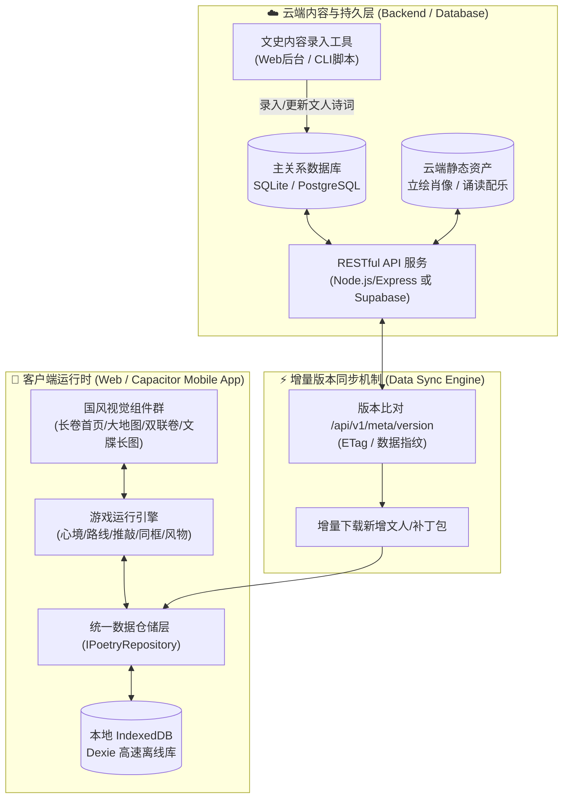
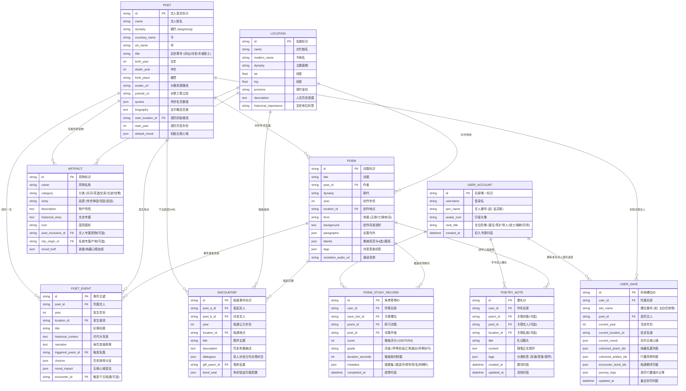

# 《唐宋山河诗境》数据库系统与动态文人内容架构设计规范
## (Database Architecture & Dynamic Content Specification)

> **文档状态**：草案评审稿（待打磨讨论）  
> **更新时间**：2026-10-28  
> **定位目标**：将《唐宋山河诗境》从静态硬编码单页应用，平滑演进为**「数据驱动、即插即用、多端同步、离线高可用」**的文化研学游戏平台。实现**在数据库中新增记录，前端长卷首页与游历系统即刻自动呈现**，无需重新编译前端代码。

---

## 目录
1. [一、 现状痛点与重构目标](#一-现状痛点与重构目标)
2. [二、 全局架构设计：离线优先双层仓储模式](#二-全局架构设计离线优先双层仓储模式)
3. [三、 核心实体 E-R 关系图与数据模型](#三-核心实体-e-r-关系图与数据模型)
4. [四、 数据库表结构规范 (DDL / Prisma Schema)](#四-数据库表结构规范-ddl--prisma-schema)
5. [五、 动态新增文人流水线 (以王维·诗摩诘为例)](#五-动态新增文人流水线-以王维诗摩诘为例)
6. [六、 存量数据无损迁移策略 (Migration Plan)](#六-存量数据无损迁移策略-migration-plan)
7. [七、 前端数据仓储层抽象 (Repository Pattern)](#七-前端数据仓储层抽象-repository-pattern)
8. [八、 标准 RESTful API 契约设计](#八-标准-restful-api-契约设计)
9. [九、 讨论重点与打磨检查清单](#九-讨论重点与打磨检查清单)

---

## 一、 现状痛点与重构目标

### 1.1 现状技术债
- **硬编码耦合严重**：四大文宗（李白、杜甫、苏轼、李清照）的生平轨迹、传世诗作、挖空题目、赏析解析均散落于 `src/data/poets/` 各 TypeScript 文件中。
- **扩展成本极高**：每新增一位诗人，必须创建 3 个 TS 文件、手动维护数十个常数、在 `src/data/poets/index.ts` 重新 import，并重新打包全量产物。
- **打包体积膨胀**：随着诗篇与历史典故逐渐丰富，全量打包至单页应用会导致首屏 JS Bundle 剧烈膨胀。
- **玩家存档孤岛**：目前仅使用本地 IndexedDB，用户清理浏览器缓存即丢失全部进度，无法跨设备（手机/电脑）无缝继承。

### 1.2 重构核心目标
1. **内容与渲染彻底解耦**：前端只保留统一的“游戏执行引擎”与“国风视觉渲染器”，所有业务对象（文人、诗词、事件、名城、风物、相遇）均由数据库提供。
2. **零代码热拔插**：在后台数据库执行一次 `INSERT` 或通过管理员工具录入，前端长卷首页即可动态拉取该文人，自动渲染其生平年谱、朝代分类与名篇推敲，全程**无需前端发版**。
3. **离线优先 (Offline-First)**：针对未来移动端（Capacitor/React Native/Webview）与弱网场景，保留本地 IndexedDB 作为全量只读缓存，断网也能畅玩已下载诗篇。
4. **云端安全存档**：支持玩家进度（五维心境、背包信物、已过关卡、羁绊印章）定时或触发式同步至云端。

---

## 二、 全局架构设计：离线优先双层仓储模式

为兼顾**动态更新能力**与**移动端无网流畅游历**，系统采用**「云端权威源 + 本地增量缓存」**的双层仓储设计：



### 数据加载与同步流程：
1. **初次启动**：前端内置一份基础快照包（或启动时一次性从 `/api/v1/manifest` 拉取完整种子数据），存入本地 IndexedDB。
2. **日常游历**：引擎直接读取 IndexedDB，实现 **0ms 延迟、无网全功能运行**。
3. **后台更新**：后台录入新诗人（如王维）后，主数据版本号自增（如 `v1.2.0`）。前端在联网状态下检测到版本号变更，后台静默拉取增量数据并合并入本地库，长卷首页即刻出现“新文人已收录”微光提示。

---

## 三、 核心实体 E-R 关系图与数据模型

游戏由 6 张核心主数据表与 2 张用户进度表构成：



---

## 四、 数据库表结构规范 (DDL / Prisma Schema)

以行业标准的 **Prisma Schema (可编译映射至 SQLite / PostgreSQL / MySQL)** 为基准：

```prisma
// datasource 声明：开发期推荐使用 sqlite，生产/云端一键切换为 postgresql
datasource db {
  provider = "sqlite"
  url      = env("DATABASE_URL")
}

generator client {
  provider = "prisma-client-js"
}

// 1. 文人主表
model Poet {
  id                String       @id
  name              String
  dynasty           String       // "tang" | "song"
  courtesyName      String?      // 字
  artName           String?      // 号
  title             String       // "诗仙" / "诗圣" / "千古第一才女"
  birthYear         Int
  deathYear         Int
  birthPlace        String
  avatarUrl         String
  portraitUrl       String
  quotes            String       // JSON 数组序列化
  biography         String
  startLocationId   String
  startYear         Int
  defaultMood       String       // JSON: { passion, sorrow, freedom, anger, homesickness }
  createdAt         DateTime     @default(now())
  updatedAt         DateTime     @updatedAt

  events            PoetEvent[]
  poems             Poem[]
  artifacts         Artifact[]   @relation("PoetExclusiveArtifacts")
  userSaves         UserSave[]
}

// 2. 名城古迹表
model Location {
  id                   String      @id
  name                 String      // "长安"
  modernName           String      // "西安"
  dynasty              String      // "tang"
  lat                  Float
  lng                  Float
  province             String
  description          String
  historicalImportance String
  
  events               PoetEvent[]
  poems                Poem[]
  artifacts            Artifact[]  @relation("CitySpecialtyArtifacts")
}

// 3. 人生纪事与重大抉择表
model PoetEvent {
  id                String      @id
  poetId            String
  year              Int
  locationId        String
  title             String      // "长安供奉翰林"
  historicalContext String
  narrative         String
  triggeredPoemId   String?     // 可为空或关联具体诗词
  choices           String      // JSON: 分支抉择项与心境奖惩
  moodImpact        String      // JSON: 心境直接变化
  encounterId       String?     // 触发千古相遇
  
  poet              Poet        @relation(fields: [poetId], references: [id])
  location          Location    @relation(fields: [locationId], references: [id])
  triggeredPoem     Poem?       @relation("TriggeredPoem", fields: [triggeredPoemId], references: [id])
}

// 4. 传世名篇与推敲题库表
model Poem {
  id                  String      @id
  title               String      // "蜀道难"
  poetId              String
  dynasty             String
  year                Int
  locationId          String
  form                String      // "七言古诗"
  background          String      // 创作背景
  paragraphs          String      // JSON: string[]
  blanks              String      // JSON: BlankChallenge[] (包含4选1选项、错项诱导解析、正解)
  tags                String      // JSON: string[]
  recitationAudioUrl  String?     // 名家音频或 TTS 参数
  
  poet                Poet        @relation(fields: [poetId], references: [id])
  location            Location    @relation(fields: [locationId], references: [id])
  triggeredEvents     PoetEvent[] @relation("TriggeredPoem")
}

// 5. 山河风物志表
model Artifact {
  id                String      @id
  name              String      // "太白青锋宝剑"
  category          String      // "weapon" | "tea_wine" | "stationery" | "relic" | "food"
  rarity            String      // "legendary" | "epic" | "rare"
  description       String
  historicalStory   String
  icon              String
  poetExclusiveId   String?     // 关联专属文人
  cityOriginId      String?     // 关联产地名城
  moodBuff          String?     // JSON: 装备心境修正属性
  
  poetExclusive     Poet?       @relation("PoetExclusiveArtifacts", fields: [poetExclusiveId], references: [id])
  cityOrigin        Location?   @relation("CitySpecialtyArtifacts", fields: [cityOriginId], references: [id])
}

// 6. 千古相遇羁绊表
model Encounter {
  id              String      @id
  poetAId         String
  poetBId         String
  year            Int
  locationId      String
  title           String      // "日与月相撞 · 洛阳初遇"
  description     String
  dialogues       String      // JSON: DialogueTurn[] (双人立绘对话流)
  giftPoemId      String?     // 互赠名篇
  bondSeal        String      // JSON: 朱砂羁绊方印名与样式
}

// 7. 用户账户表
model UserAccount {
  id                String       @id
  username          String       @unique
  penName           String       // 文人雅号 (如: 姑苏客)
  avatarIcon        String       // 印章头像标示
  rankTitle         String       // "童生" | "秀才" | "举人" | "进士及第" | "翰林学士" | "一代文宗"
  createdAt         DateTime     @default(now())

  saves             JourneySave[]
  studyRecords      PoemStudyRecord[]
  notes             PoetryNote[]
}

// 8. 游历多槽位存档表 (山河谱牒)
model JourneySave {
  id                   String      @id
  userId               String
  slotName             String      // "太白任侠一梦"
  poetId               String
  currentYear          Int
  currentLocationId    String
  currentMood          String      // JSON: MoodState
  unlockedPoemIds      String      // JSON: string[]
  poemScores           String      // JSON: Record<string, number>
  unlockedArtifactIds  String      // JSON: string[]
  unlockedBondIds      String      // JSON: string[]
  choicesMade          String      // JSON: Record<string, string>
  journeyLogs          String      // JSON: Array<{ year, location, event }>
  updatedAt            DateTime    @updatedAt

  user                 UserAccount @relation(fields: [userId], references: [id])
  poet                 Poet        @relation(fields: [poetId], references: [id])
}

// 9. 诗词推敲默写答卷表 (推敲朱卷 & 错题集)
model PoemStudyRecord {
  id                String      @id
  userId            String
  saveSlotId        String
  poemId            String
  poetId            String
  score             Int         // 100 | 75 | 50
  grade             String      // "甲等·妙品" | "乙等·通达" | "丙等·尚可"
  durationSeconds   Int
  mistakes          String      // JSON: Array<{ lineIndex, charIndex, chosenOption, correctOption, explanation }>
  completedAt       DateTime    @default(now())

  user              UserAccount @relation(fields: [userId], references: [id])
  poem              Poem        @relation(fields: [poemId], references: [id])
}

// 10. 文心墨札笔记表
model PoetryNote {
  id                String      @id
  userId            String
  poemId            String?     // 可选关联诗篇
  poetId            String?     // 可选关联文人
  locationId        String?     // 可选关联名城
  title             String      // 札记题头
  content           String      // 随笔正文
  tags              String      // JSON: string[]
  createdAt         DateTime    @default(now())
  updatedAt         DateTime    @updatedAt

  user              UserAccount @relation(fields: [userId], references: [id])
}
```

---

## 五、 动态新增文人流水线 (以王维·诗摩诘为例)

当开发者或策划想要新增一位新文人（例如【王维】）时，**无需触碰任何 React 页面代码**，只需准备一份规范的 JSON/YAML 数据并执行入库命令：

### 5.1 准备数据包 (`content/poets/wang_wei.json`)
```json
{
  "poet": {
    "id": "wang_wei",
    "name": "王维",
    "dynasty": "tang",
    "courtesyName": "摩诘",
    "artName": "摩诘居士",
    "title": "诗佛",
    "birthYear": 701,
    "deathYear": 761,
    "birthPlace": "蒲州（今山西永济）",
    "avatarUrl": "/assets/portraits/wang_wei_avatar.jpg",
    "portraitUrl": "/assets/portraits/wang_wei_full.jpg",
    "quotes": ["行到水穷处，坐看云起时。", "明月松间照，清泉石上流。"],
    "biography": "唐代著名诗人、画家。字摩诘，号摩诘居士。参禅悟理，诗凝静穆禅趣，苏轼赞其“诗中有画，画中有诗”。",
    "startLocationId": "chang_an",
    "startYear": 721,
    "defaultMood": { "passion": 50, "sorrow": 20, "freedom": 85, "anger": 10, "homesickness": 40 }
  },
  "artifacts": [
    {
      "id": "wang_wei_pipa",
      "name": "郁轮袍琵琶",
      "category": "relic",
      "rarity": "legendary",
      "description": "王维青年入京，于岐王宅邸独奏《郁轮袍》名动京华之雅器。",
      "historicalStory": "《唐才子传》载：维妙年洁白，风姿郁美，工琵琶，游豪门，一曲《郁轮袍》倾倒玉真公主。",
      "icon": "Music",
      "poetExclusiveId": "wang_wei"
    }
  ],
  "events": [
    {
      "id": "wang_wei_721_jinshi",
      "poetId": "wang_wei",
      "year": 721,
      "locationId": "chang_an",
      "title": "及第登第 · 太乐丞",
      "historicalContext": "玄宗开元九年，二十一岁的王维擢进士第，授太乐丞。",
      "narrative": "长安春晓，朱雀大街琼林赴宴。春风得意之时，你深知乐极生悲之禅理……",
      "triggeredPoemId": "wang_wei_xiang_si",
      "choices": [
        {
          "id": "choice_modest",
          "text": "清心守正，潜研佛理画道",
          "moodImpact": { "freedom": 15, "sorrow": -5 }
        }
      ],
      "moodImpact": { "freedom": 10 }
    }
  ],
  "poems": [
    {
      "id": "wang_wei_xiang_si",
      "title": "相思",
      "poetId": "wang_wei",
      "dynasty": "tang",
      "year": 721,
      "locationId": "chang_an",
      "form": "五言绝句",
      "background": "天宝之乱前，王维在江汉之游中为眷念故友李龟年等所作名篇。",
      "paragraphs": [
        "红豆生南国，",
        "春来发几枝。",
        "愿君多采撷，",
        "此物最相思。"
      ],
      "blanks": [
        {
          "lineIndex": 2,
          "charIndex": 4,
          "blankText": "撷",
          "options": ["撷", "惜", "折", "剪"],
          "correctOption": "撷",
          "explanation": "‘采撷’为文雅摘取之意，若用‘采折’则伤枝蔓，韵味全失。"
        }
      ],
      "tags": ["相思", "借物抒怀", "五言绝句"]
    }
  ]
}
```

### 5.2 执行入库命令
```bash
npm run db:import -- content/poets/wang_wei.json
```
入库脚本会自动校验外键一致性（确保城池 ID `chang_an` 合法）、生成唯一哈希并更新元数据版本号。

### 5.3 客户端即刻呈现
- 玩家打开游戏，首页组件通过统一仓储接口 `PoetryRepository.getPoets()` 动态获取列表。
- 首页唐宋分类中，唐代列别中**自动展现【诗佛·王维】立绘卡片、传世名句与生平简介**。
- 点击【开启王维生平游历】，游戏引擎立即载入其开元九年及第剧情、郁轮袍琵琶信物与《相思》研学关卡！

---

## 六、 存量数据无损迁移策略 (Migration Plan)

当前项目中已有 4 位名家（李白、杜甫、苏轼、李清照）与 16 座名城的丰富数据。必须确保在切入数据库体系时**零数据丢失、无缝平移**。

### 6.1 迁移脚本设计 (`scripts/migrate-static-to-db.ts`)
1. **城池表迁移**：读取 `src/data/locations.ts`，自动抽取 16 座名城转为 `Location` 记录。
2. **文人与年谱迁移**：依次遍历 `src/data/poets/li_bai/`、`du_fu/`、`su_shi/`、`li_qingzhao/`，将 `poet`、`events.ts`、`poems.ts` 解析并插入对应表。
3. **风物与相遇迁移**：读取 `src/data/artifacts/index.ts`（28 件风物信物）与 `src/data/encounters/index.ts`（三大千古相遇），关联主外键存入。
4. **生成静态种子文件**：在数据库生成完毕后，自动产出一份 `public/data/seed-bundle.json`。该文件不仅作为本地 SQLite 的初始种子，还能作为离线 PWA/手机 App 的首包预埋数据。

---

## 七、 前端数据仓储层抽象 (Repository Pattern)

为确保前端 UI 组件与底层数据存储方式彻底解耦，定义统一的仓储接口：

```typescript
// src/services/repository/types.ts

export interface IPoetryRepository {
  // 元数据与版本
  getDataVersion(): Promise<string>;
  syncWithRemote(): Promise<boolean>;

  // 文人接口
  getAllPoets(dynasty?: 'tang' | 'song'): Promise<PoetData[]>;
  getPoetById(id: string): Promise<PoetData | null>;

  // 游历年谱与关卡
  getEventsByPoetId(poetId: string): Promise<PoetEventData[]>;
  getPoemById(poemId: string): Promise<PoemData | null>;
  getAllPoemsByPoetId(poetId: string): Promise<PoemData[]>;

  // 名城与风物
  getAllLocations(): Promise<LocationData[]>;
  getArtifacts(): Promise<ArtifactItem[]>;
  getEncounters(): Promise<PoetEncounterData[]>;

  // 云存档接口
  loadUserSave(poetId: string): Promise<GameSaveState | null>;
  saveUserProgress(save: GameSaveState): Promise<void>;
}
```

### 降级与兜底策略 (Failover)：
- **网络畅通时**：优先比对云端最新文人包；
- **网络异常/完全断网时**：透明降级为读取本地 IndexedDB 缓存；
- **首次安装无网时**：直接读取本地内置的初始种子数据包，确保任何极端网络环境下均不白屏、不卡死。

---

## 八、 标准 RESTful API 契约设计

如果选择自建轻量后端（Node.js / Express），API 接口清晰简洁：

| 端点 (Endpoint) | 方法 | 作用 | 响应说明 |
| :--- | :---: | :--- | :--- |
| `/api/v1/meta/manifest` | `GET` | 获取当前内容版本号与实体摘要 | 返回 `{ version: "1.2.0", poetCount: 5, hash: "..." }` |
| `/api/v1/poets` | `GET` | 获取文人列表（长卷首页用） | 支持 `?dynasty=tang`，返回文人概览卡片列表 |
| `/api/v1/poets/:id/journey` | `GET` | 一次性获取文人全量生平包 | 包含文人详情、全部事件、关联诗篇、本命风物 |
| `/api/v1/locations` | `GET` | 获取十六名城全量坐标与人文风物 | 返回全国舆图点位数据 |
| `/api/v1/encounters` | `GET` | 获取千古相遇羁绊列表 | 返回同框对话流与羁绊印鉴 |
| `/api/v1/saves/sync` | `POST` | 双向同步玩家云存档 | 上传本地进度，返回最新服务端云存档 |
| `/api/v1/admin/poets` | `POST` | (管理员权限) 动态录入新诗人 | 校验合法性后写入数据库并触发全服版本递增 |

---

## 九、 讨论重点与打磨检查清单

在正式动手编写代码前，请您重点审阅并与我探讨以下几点设计取向：

> [!NOTE] 核心决策点
> 1. **后端数据库形态偏好**：
>    - **方案 A（极简单包 / 推荐）**：使用 **Node.js + SQLite (Prisma)**。项目内自闭环，轻量、无需配置外部云服务，可方便导出 `.sqlite` 文件备份，也可随时部署上云。
>    - **方案 B（全托管云服务）**：使用 **Supabase (云端 Postgres)**。您可以在网页上直接打开可视化表格录入诗人，免去运维后端的繁琐。
> 2. **多媒体静态资源的存放策略**：
>    - 诗人的超清立绘（如李白/杜甫/王维画像）与配乐音频，是存放在前端 `public/assets/` 静态打包，还是存放在对象存储（如 OSS / CDN）以便动态按需下载？
> 3. **管理后台的需求深度**：
>    - 是先提供**「JSON / YAML 脚本一键入库」**的方式（轻量极速），还是后续需要开发一个**可视化 Web 录入后台**？

---
*本文档已同步归档至项目 `doc/DATABASE_AND_DYNAMIC_CONTENT_SPEC.md` 与会话知识库中，可随时根据讨论意见持续修正。*
