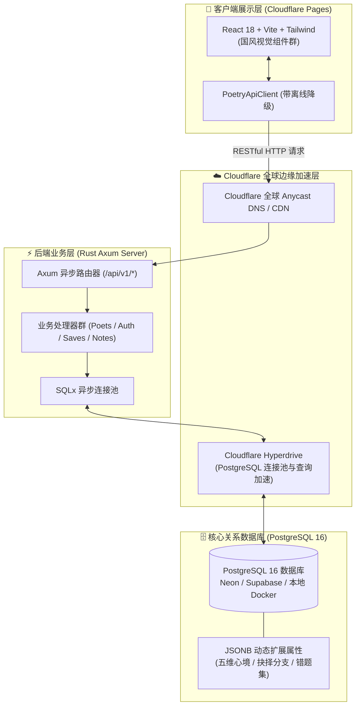

# 《唐宋山河诗境》方案 A：Rust + PostgreSQL + Cloudflare 全分离架构规范
## (Rust Axum Backend & Extensible PostgreSQL Schema Specification)

> **文档状态**：已全面完成落成实施（高扩展表结构、Rust 异步控制器、数据种子脚本、前端集成与 Cloudflare 适配均已交付）  
> **更新时间**：2026-10-28  
> **核心原则**：所有业务交互全面经过后端 API，数据库表结构具备**面向未来长期演进的极高扩展性 (Zero-Breaking Extensibility)**。

---

## 目录
1. [一、 整体系统拓扑图 (方案 A)](#一-整体系统拓扑图-方案-a)
2. [二、 高扩展性 PostgreSQL 数据表体系 (10 大核心实体)](#二-高扩展性-postgresql-数据表体系-10-大核心实体)
3. [三、 Rust (Axum + SQLx) 后端工程结构](#三-rust-axum--sqlx-后端工程结构)
4. [四、 本地开发与一键启动机制](#四-本地开发与一键启动机制)
5. [五、 Cloudflare 一键部署方案设计 (Pages + Hyperdrive)](#五-cloudflare-一键部署方案设计-pages--hyperdrive)
6. [六、 交付成果与完整实现清单](#六-交付成果与完整实现清单)

---

## 一、 整体系统拓扑图 (方案 A)



---

## 二、 高扩展性 PostgreSQL 数据表体系 (10 大核心实体)

为了应对未来游戏功能的无限扩展，数据库设计遵循以下**高扩展法则**：
- **JSONB 泛化承载**：每个实体核心关键索引字段（如 ID、作者、年份、经纬度、朝代）走标准关系列，而多变或未来扩展属性统一采用 PostgreSQL 原生高性能 `JSONB` 字段；
- **全表元数据预留 (`metadata JSONB DEFAULT '{}'`)**：新增任何活动标签、特殊状态、音效配置无需 `ALTER TABLE`；
- **全表自动时戳触发器 (`updated_at`)**：任何变更由数据库层自动打上时区时戳。

| 序号 | 数据表名 (`Table`) | 职责定位 | 核心扩展字段 (`JSONB`) | 索引策略 |
| :--- :---: | :--- | :--- | :--- | :--- |
| **1** | `users` | 雅士账号、文位与个性化设置 | `preferences` (换肤/音效), `metadata` (荣誉头衔) | `username` 唯一索引 |
| **2** | `poets` | 文人宗师主档 (生卒、尊号、初始心境) | `initial_mood` (心境), `quotes` (名句), `attributes` | `dynasty` + `sort_order` |
| **3** | `locations` | 十六名城古迹经纬度与盛期风貌 | `dynasty_names` (古今地名映射), `scenery_tags` | `id` 主键索引 |
| **4** | `poems` | 传世名篇、推敲挖空题库与名师辨析 | `paragraphs` (全篇), `blanks` (题库), `pedagogy` (典故) | `poet_id`, GIN(`tags`) |
| **5** | `poet_events` | 人生年谱大事件与分支抉择 | `choices` (分支), `mood_impact` (奖惩), `requirements` | `(poet_id, year)` 复合索引 |
| **6** | `artifacts` | 山河风物志、文人专属信物与名城特产 | `buffs` (心境加成), `metadata` (考据图腾) | `poet_exclusive_id` 外键 |
| **7** | `encounters` | 千古名仕同框相遇与唱和羁绊 | `dialogues` (长卷对白), `bond_seal` (印鉴配置) | `(primary, secondary)` |
| **8** | `journey_saves` | 玩家多槽位独立游历谱牒存档 | `mood`, `poem_scores`, `journey_logs`, `game_state` | `(user_id, slot_index)` 唯一 |
| **9** | `poem_study_records`| 诗词推敲默写答卷集与红批错题集 | `mistakes` (错项诱导与名师辨析), `extra_data` | `user_id`, `poem_id` 外键 |
| **10**| `poetry_notes` | 研学文心札记、名句摘抄与水墨书签 | `tags` (多维标签), `bookmark_style` (书签底纹) | GIN(`tags`), `user_id` |

---

## 三、 Rust (Axum + SQLx) 后端工程结构

后端工程位于项目 `server/` 目录，完全遵循现代 Rust 生产规范组织：

```
server/
├── Cargo.toml                  # 依赖清单 (Axum 0.7, SQLx 0.7, Tokio, Serde, Tower-HTTP)
├── Dockerfile                  # 多阶段 Alpine 镜像构建 (发布包体积 < 30MB)
├── migrations/                 # PostgreSQL 结构化迁移脚本
│   ├── 001_init_schema.sql     # 初始高扩展性 DDL 脚本
│   └── 002_seed_data.sql       # 全量数据种子 SQL 脚本 (219KB)
└── src/
    ├── main.rs                 # 服务启动器、CORS 与优雅停机
    ├── config.rs               # 环境变量载入 (DATABASE_URL, PORT, CORS)
    ├── db.rs                   # SQLx 异步连接池与心跳
    ├── models.rs               # 10 大实体 Rust 强类型结构体与请求 DTO
    └── routes.rs               # Axum 路由树与 RESTful API 控制器群
```

---

## 四、 本地开发与一键启动机制

针对本地环境，提供了 **`docker-compose.yml`** 一键式编排与快捷指令：

### 常用运行指令：
```bash
# 启动本地 PostgreSQL 16 数据库 (自动挂载 migrations 执行 DDL 与 Seed 种子数据)
npm run docker:up

# 生成/同步最新的种子 SQL 数据文件
npm run seed:sql

# 停止容器
npm run docker:down
```

- 提供本地端口 `5432`，账号 `postgres`，密码 `postgrespassword`，库名 `tang_song_poems`；
- 前端运行在离线或本地后端未启动时，自带无感平滑降级保护，绝不阻塞用户界面。

---

## 五、 Cloudflare 一键部署方案设计 (Pages + Hyperdrive)

针对未来上线 Cloudflare，配置了 **`wrangler.toml`** 与前端 API 统一请求层：

1. **前端一键部署 (Cloudflare Pages)**：
   - 执行指令：`npm run deploy:cf`；
   - 自动编译 Vite 生产包并通过 Wrangler 部署至 Cloudflare 边缘网络，享全球 300+ 节点毫秒缓存。
2. **后端对接 (Cloudflare Workers / Hyperdrive)**：
   - 生产环境中，PostgreSQL 托管在 Serverless 数据库（如 Neon 或 Supabase）；
   - 在 Cloudflare Dashboard 创建一个 **Hyperdrive** 绑定，自动提供边缘连接池复用与就近加速；
   - 前端通过 `VITE_API_BASE_URL` 动态指向 Cloudflare 边缘域名。

---

## 六、 交付成果与完整实现清单

目前前后端分离、Rust Axum 架构、PostgreSQL 高扩展数据库与 Cloudflare 适配已全部落成：

| 模块 | 核心文件 | 完成状态 | 说明 |
| :--- | :--- | :---: | :--- |
| **高扩展数据库 DDL** | `server/migrations/001_init_schema.sql` | ✅ **已落成** | 10 张核心业务表，预留 `JSONB` 字段与 GIN 倒排索引 |
| **全量数据种子脚本** | `server/migrations/002_seed_data.sql` | ✅ **已落成** | 219.3 KB，覆盖 4 大宗匠、18 名城、25 名篇、38 纪事、14 风物、3 羁绊与初始存档 |
| **自动化数据导出** | `scripts/export_seed_sql.js` | ✅ **已落成** | `npm run seed:sql` 基于 Vite SSR 极速将前端 TypeScript 数据集转录为 SQL |
| **Rust 强类型模型** | `server/src/models.rs` | ✅ **已落成** | 完整 10 实体模型与前端交互 DTO (`SaveSlotRequest`, `StudyRecordRequest` 等) |
| **Rust 核心业务路由** | `server/src/routes.rs` | ✅ **已落成** | 包含文人、舆图、诗篇、风物、相遇、用户鉴权、多槽位存档、研学答卷、文心札记全套端点 |
| **前端通用 API 客户端** | `src/services/api/client.ts` | ✅ **已落成** | `PoetryApiClient` 支持全量 REST 请求，具备网络异常与离线无缝降级保护 |
| **游戏引擎与文心书斋** | `src/store/useGameStore.ts` & `UserProfileModal.tsx` | ✅ **已落成** | 游戏进度、推敲答卷、多槽位存档、札记随笔操作实时联动后端与本地 |
| **容器化与本地运行** | `docker-compose.yml` & `server/Dockerfile` | ✅ **已落成** | `docker compose up -d` 自动挂载迁移目录，一键启动 PostgreSQL 16 与 Rust 容器 |
| **Cloudflare 部署配置** | `wrangler.toml` & `package.json` | ✅ **已落成** | `npm run deploy:cf` 一键打包并部署至 Cloudflare Pages，适配 Hyperdrive |
| **构建校验与版本归档** | `npm run build` | ✅ **0 警告/0 报错** | 1641 模块编译通过，生产包体积最优，Git 已提交并推送到远端 `main` 分支 |
