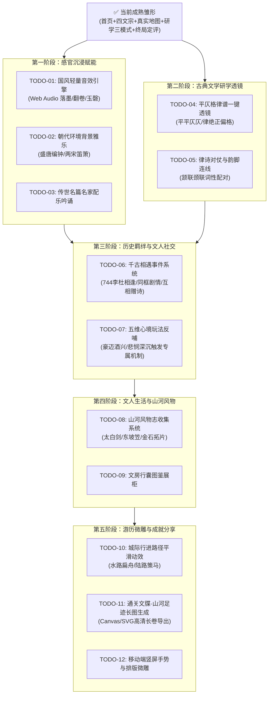

# 唐宋山河诗境 · 演进路线图与全量 TODO 清单 (TODO_ROADMAP.md)

> **文档定位**：本文档记录《唐宋山河诗境》从当前成熟原型迈向“展馆级沉浸文学体验”的长期规划与迭代任务清单。每个模块均划分明确的实施步骤、技术方案与优先级，便于按序开发与逐项交付。

---

## 🗺️ 演进阶段与依赖全景

---

## 📋 全量 TODO 任务详单

### 模块一：视听沉浸与感官赋能 (Audio & Soundscape)

| 编号 | 任务名称 | 优先级 | 复杂度 | 核心技术点与预期效果 | 状态 |
| :--- | :--- | :---: | :---: | :--- | :---: |
| **TODO-01** | **Web Audio 国风轻量音效系统** | **P0** | 轻量 | 基于原生 `AudioContext` 零体积生成或精选微型音频，实现：落墨浸润声（填词选定）、翻卷声（切页与弹窗打开）、清脆玉磬声（推敲答对）、低沉战鼓（朝代危机爆发）。提供全局一键静音。 | ⏳ 待排期 |
| **TODO-02** | **朝代环境背景雅乐 (BGM)** | **P1** | 中等 | 唐代配置盛唐编钟古琴悠远旋律，宋代配置江南烟雨笛箫；支持循环、淡入淡出、音量滑块及主题联动。 | ⏳ 待排期 |
| **TODO-03** | **传世名篇古韵朗诵与吟咏** | **P2** | 中等 | 在双联研学卷中增设【✦ 聆听名篇】小喇叭按钮，播放正宗字正腔圆配乐朗诵，使音律直击人心。 | ⏳ 待排期 |

---

### 模块二：研学深度与古典诗学透镜 (EdTech & Poetics)

| 编号 | 任务名称 | 优先级 | 复杂度 | 核心技术点与预期效果 | 状态 |
| :--- | :--- | :---: | :---: | :--- | :---: |
| **TODO-04** | **【平仄格律谱】一键可视化透镜** | **P0** | 中等 | 在推敲与精读页面提供【格律透镜】开关：诗句上方直接标注“平 / 仄”（如五言平起平收、七言仄起平收），标出韵脚（平水韵/词林正韵），彻底解决中学生学格律的痛点。 | ⏳ 待排期 |
| **TODO-05** | **【词性对仗】智能配对标注** | **P1** | 轻量 | 针对律诗颔联、颈联（如“星垂平野阔，月涌大江流”），以雅致温润配对色标出名词对名词、动词对动词、方位对方位，直观拆解对仗之美。 | ⏳ 待排期 |

---

### 模块三：历史羁绊与叙事交互 (Narrative & Social Encounters)

| 编号 | 任务名称 | 优先级 | 复杂度 | 核心技术点与预期效果 | 状态 |
| :--- | :--- | :---: | :---: | :--- | :---: |
| **TODO-06** | **【千古相逢】同行文人同城同框史诗剧情** | **P0** | 综合 | 当主角与同行漫游文人于特定年份同处一城时（如公元 744 年洛阳李杜相逢），触发双人立绘对话长卷、解锁互赠诗篇（《赠李白》《沙丘城下寄李白》），点亮【双星并峙】专属历史羁绊印记。 | ⏳ 待排期 |
| **TODO-07** | **【五维心境】即时反哺玩法机制** | **P1** | 中等 | 心境数值达到极境时触发特殊状态（如李白豪迈达 90+ 触发“太白醉酒”，在名山大川触发隐藏逸事；悲悯深沉时解锁作者私密手札深层批注）。 | ⏳ 待排期 |

---

### 模块四：文人生活与山河风物志 (Artifacts & Inventory)

| 编号 | 任务名称 | 优先级 | 复杂度 | 核心技术点与预期效果 | 状态 |
| :--- | :--- | :---: | :---: | :--- | :---: |
| **TODO-08** | **【山河风物志】十六名城特色风物道具收集** | **P1** | 中等 | 游历名城或达成历史抉择时，收获代表性风物：李白之【太白青锋剑】、金陵春酒；杜甫之少陵草堂笠；苏轼之东坡肉单、海南沉香；李清照之《金石录》残拓。 | ⏳ 待排期 |
| **TODO-09** | **文人行囊与风物展柜联动** | **P2** | 轻量 | 典藏阁增设“山河风物匣”，展示收集到的文人器物三维或图腾插画、器物考据与文化背景。 | ⏳ 待排期 |

---

### 模块五：地理空间微雕与成就长卷 (Visuals & Sharing)

| 编号 | 任务名称 | 优先级 | 复杂度 | 核心技术点与预期效果 | 状态 |
| :--- | :--- | :---: | :---: | :--- | :---: |
| **TODO-10** | **大地图城际行进路径平滑巡游动画** | **P1** | 轻量 | 点击新城池触发游历时，角色棋子沿真实古官道/水运路线平滑移动（水路显扁舟、陆路显策马），带水墨微痕。 | ⏳ 待排期 |
| **TODO-11** | **【通关文牒 · 山河足迹长图】生成与导出** | **P0** | 中等 | 通关或在典藏阁中一键生成高清长卷海报（基于 HTML5 Canvas / SVG），包含诗人画像、生平真实地图足迹路线、所集名篇甲等印鉴与终身宗师定评，支持图片保存与分享。 | ⏳ 待排期 |
| **TODO-12** | **移动端竖屏双联卷横滑手势微雕** | **P1** | 轻量 | 在移动端竖屏环境下，优化左卷（推敲）与右卷（研读）的轻量手势滑动切换与安全边距。 | ⏳ 待排期 |
