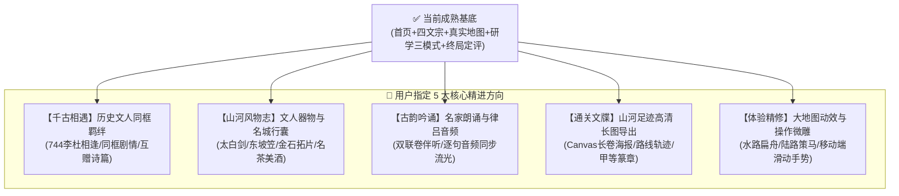

# 唐宋山河诗境 · 演进路线图与全量 TODO 清单 (TODO_ROADMAP.md)

> **文档定位**：本文档为《唐宋山河诗境》后续迭代规划的**常驻跟踪基准**。将用户重点关注的**千古相遇、山河风物志、古韵吟诵、通关文牒长图、现有模块体验精修**全面拆解为清晰的子任务、技术方案与验收标准，便于后续按序开发与逐项交付。

---

## 🗺️ 核心演进全景架构



---

## 📋 5 大核心模块 TODO 详单与实施规划

---

### 一、 【千古相遇】历史文人同框羁绊系统 (Ancient Encounters & Bonds)

> **核心目标**：将大地图上目前各自漫游的文人编织入真实历史社交网络，重现中国文学史上最璀璨的文人相逢。

| 任务编号 | 子任务与功能点 | 详细技术方案与预期表现 | 优先级 | 状态 |
| :--- | :--- | :--- | :---: | :---: |
| **TODO-ENC-01** | **时空碰撞触发器 (Spatiotemporal Collision)** | 扩展 `src/data/encounters/`。当主角行历至特定年份与城池，若与同行漫游文人（杜甫、高适、王维等）空间重合时（如公元 744 年洛阳/梁宋·李杜初遇），优先触发史诗相遇弹窗。 | **P0** | ⏳ 待开始 |
| **TODO-ENC-02** | **双人对坐立绘对话长卷 (Dual-Portrait Dialogue Modal)** | 采用展馆级双人水墨对坐立绘展陈（如李白白衣对酌、杜甫少陵野老），呈现考究的历史对白与文学碰撞（如天宝初年失意的太白与青年求仕的少陵）。 | **P0** | ⏳ 待开始 |
| **TODO-ENC-03** | **互赠诗篇与专属双向解锁** | 相遇后直接解锁文人间互赠的传世名篇（如李白解锁《戏赠杜甫》、杜甫解锁《赠李白》《冬日有怀李白》），并将其录入二人典藏诗卷。 | **P1** | ⏳ 待开始 |
| **TODO-ENC-04** | **千古羁绊印章与典藏录 (Bond Lore)** | 达成相遇后，点亮专属羁绊成就（如【双星辉映】李白×杜甫、【东坡赤壁游】苏轼×佛印），可在典藏阁中随时重温对话与历史考据。 | **P1** | ⏳ 待开始 |

---

### 二、 【山河风物志】十六名城风物与文人行囊系统 (Travel Artifacts & Inventory)

> **核心目标**：突破纯文字与诗篇收集，还原唐宋文人的物质生活美学、随身器物与名城物产风貌。

| 任务编号 | 子任务与功能点 | 详细技术方案与预期表现 | 优先级 | 状态 |
| :--- | :--- | :--- | :---: | :--- |
| **TODO-ART-01** | **行囊与风物数据层 (Inventory Schema)** | 在 `src/types/` 中定义 `ArtifactItem`（分类：`weapon` 兵刃文玩、`tea_wine` 佳酿名茶、`stationery` 笔墨纸砚、`relic` 金石古物、`food` 特色饮食）。 | **P0** | ⏳ 待开始 |
| **TODO-ART-02** | **四大文人专属本命信物配置** | 为各文人配置专属历史传家信物：<br>• **李白**：【太白青锋宝剑】、【金陵春酒葫芦】；<br>• **杜甫**：【少陵野老草堂笠】、【秋风齐赵良弓】；<br>• **苏轼**：【东坡笠屐】、【煨肉食单法帖】、【海南沉香】；<br>• **李清照**：【《金石录》残拓卷】、【漱玉泉古琴】。 | **P0** | ⏳ 待开始 |
| **TODO-ART-03** | **十六历史都会风物探索获取** | 行历至名城（如金陵得金陵春酒、广陵得淮南剪刀与雕版、汴京得樊楼御酒、临安得龙井新茶、剑阁得蜀锦），通过名城人文探索或诗词推敲甲等彩蛋获得。 | **P1** | ⏳ 待开始 |
| **TODO-ART-04** | **典藏阁【山河风物匣】展陈 UI** | 在 `CollectionModal.tsx` 中增设【风物匣】Tab，呈现温润博古架展柜，点击风物展示三维图腾、历史考证出处与趣味小传。 | **P1** | ⏳ 待开始 |

---

### 三、 【古韵吟诵】传世名篇名家配音与律吕吟唱 (Poem Recitation & Audio)

> **核心目标**：让诗词从“纸上文字”升华为“音律入耳”，借助声音重现唐诗之铿锵、宋词之依声填词。

| 任务编号 | 子任务与功能点 | 详细技术方案与预期表现 | 优先级 | 状态 |
| :--- | :--- | :--- | :---: | :--- |
| **TODO-REC-01** | **音频播放器核心模块 (AudioPlayer Engine)** | 封装统一的 `usePoemAudio` 状态管理 Hook，支持音频流按需预载、播放/暂停、音量控制及自动淡出。 | **P0** | ⏳ 待开始 |
| **TODO-REC-02** | **研学双联卷【✦ 聆听古韵】控件** | 在 `PoemAssemblyModal.tsx`（左卷推敲与右卷研读顶栏）增设优雅的【✦ 聆听名家朗诵】青玉播音胶囊，提供声波律动波形微动效。 | **P0** | ⏳ 待开始 |
| **TODO-REC-03** | **名家配乐朗诵资源体系** | 接入标准正宗配乐诵读音频（或雅致琴箫吟咏音频），覆盖《蜀道难》《将进酒》《望岳》《定风波》《声声慢》等代表作。 | **P1** | ⏳ 待开始 |
| **TODO-REC-04** | **声文同步流光高亮 (Audio-Synced Highlighting)** | 朗诵播放时，随时间戳使对应诗行泛起水墨青玉温润高光（Karaoke 式古典流光），增强视听同步沉浸感。 | **P2** | ⏳ 待开始 |

---

### 四、 【通关文牒 · 山河足迹长图】生成与导出 (Travel Passport & Export)

> **核心目标**：将玩家游历一生的全部足迹、诗作与评价，凝结为一张极具纪念价值的展馆级高清长卷，供一键保存与分享。

| 任务编号 | 子任务与功能点 | 详细技术方案与预期表现 | 优先级 | 状态 |
| :--- | :--- | :--- | :---: | :--- |
| **TODO-EXP-01** | **长图绘制引擎 (Canvas / SVG Renderer)** | 采用纯前端 HTML5 Canvas 绘制引擎，无外部服务器依赖，支持高分辨率（2x/3x Retina 屏）离线渲染导出。 | **P0** | ⏳ 待开始 |
| **TODO-EXP-02** | **长卷版面美学构图设计** | 长卷内容包含：<br>① 顶部：【大唐/两宋通关文牒 · 山河行履图】金石篆额；<br>② 上半部：文人工笔立绘肖像、生平纪年、行世尊号；<br>③ 中部：华夏山河微缩舆图，以泥金连线绘制玩家亲历的全部城池轨迹；<br>④ 下半部：纳藏名篇列表、所获【甲等·妙品】朱砂红泥印鉴、五维心境评定；<br>⑤ 底部：千秋宗师权威定评与通关日期专属编码。 | **P0** | ⏳ 待开始 |
| **TODO-EXP-03** | **终局与典藏阁随时导出入口** | 在诗人终局谢幕弹窗（`PoetRetrospectiveModal`）与典藏阁（`CollectionModal`）中增设【生成我的山河通关文牒】黄金大按钮。 | **P1** | ⏳ 待开始 |
| **TODO-EXP-04** | **多端一键保存与长按存图** | 导出弹窗支持全屏预览、点击一键下载 PNG 图片；移动端提供长按保存到相册支持。 | **P1** | ⏳ 待开始 |

---

### 五、 【现有模块体验精修】细节微雕清单 (Current Experience Polish)

> **核心目标**：消除一切操作摩擦，让大地图游历、诗词交互与移动端触控体验达到丝滑水准。

| 任务编号 | 子任务与功能点 | 详细技术方案与预期表现 | 优先级 | 状态 |
| :--- | :--- | :--- | :---: | :--- |
| **TODO-POL-01** | **大地图城际平滑巡游动画 (Route Travel Animation)** | 主角从 A 城前往 B 城时，棋子沿古代官道/水驿平滑移动（长江黄河段呈现【扁舟泛波】，陆路段呈现【白马徐行】），伴随行路水墨涟漪，消除瞬移感。 | **P0** | ⏳ 待开始 |
| **TODO-POL-02** | **已游历城池名篇“旧地重温”快捷入口** | 在大地图名城弹窗（`CityDetailModal`）中，若该城池已有收录诗篇，增设直接【重温当令绝唱】跳转按键，无需重新检索。 | **P1** | ⏳ 待开始 |
| **TODO-POL-03** | **移动端竖屏双联卷横滑手势 (Swipe Gestures)** | 在手机竖屏模式下，左卷推敲与右卷研读支持单指左右平滑滑动切换，并优化虚拟键盘弹出时的视口防顶起机制。 | **P1** | ⏳ 待开始 |
| **TODO-POL-04** | **键盘快捷键与推敲极速推演** | 为桌面端玩家提供键盘快捷键：数字键 `1/2/3/4` 对应 A/B/C/D 选项，回车确认，空格听朗诵，Esc 关闭弹窗，提升操作流畅度。 | **P2** | ⏳ 待开始 |
| **TODO-POL-05** | **离线存档一键导出/导入与重置备份** | 在设置或关于页面增加存档导入/导出 JSON 功能，便于玩家跨设备备份自己的游历进度与全集诗篇。 | **P2** | ⏳ 待开始 |

---

## 🎯 建议落地执行节奏

```
[第一棒] TODO-POL-01 大地图城际平滑巡游动画 + TODO-REC-01/02 研学古韵吟诵
             ↓
[第二棒] TODO-ENC-01~04 【千古相遇】李杜洛阳初会羁绊系统
             ↓
[第三棒] TODO-ART-01~04 【山河风物志】十六名城行囊与文人信物收集
             ↓
[第四棒] TODO-EXP-01~04 【通关文牒 · 山河足迹长图】生成与导出
             ↓
[第五棒] TODO-POL-03~05 移动端手势、快捷键与体验精修收尾
```
